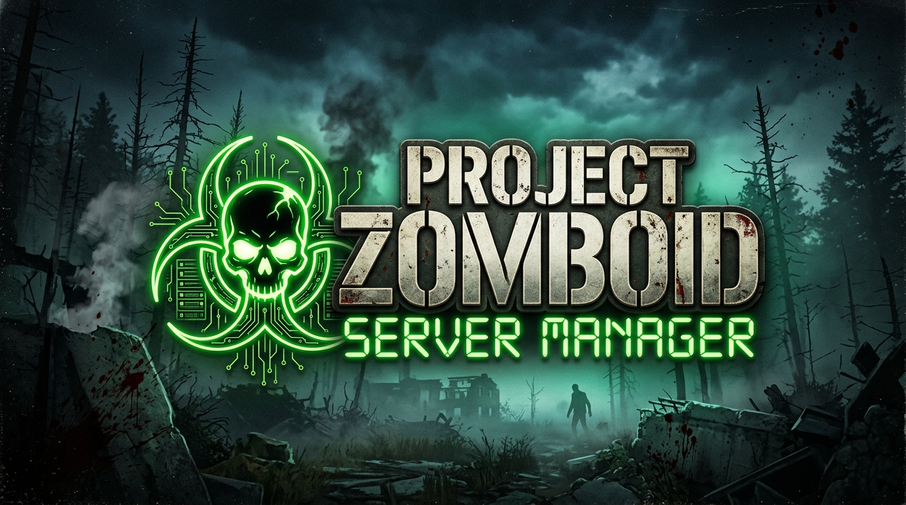

<p align="center">
  
</p>

# 🧟 Project Zomboid Dedicated Server Manager (v1.1)

[](https://python.org)
[](https://pypi.org/project/PyQt5/)
[](#-установка-и-запуск)
[](#-ключевые-возможности)
[](LICENSE)

Универсальный кроссплатформенный менеджер с графическим интерфейсом (GUI) для автоматической установки, настройки, обновления, проверки модов и управления выделенным сервером игры **Project Zomboid** (поддерживает **Build 41** и **Build 42+**).

Поддерживает работу на **Windows (10/11)** и **Linux (Ubuntu, Debian, Fedora, Arch)**.

---

## 🌟 Ключевые возможности

### 🛠️ 1. Установка и умное обновление сервера (SteamCMD)
* **Поддержка актуальных версий игры**: автоматический выбор ветки сервера в Steam: `42.21`, `42.20`, `public`, `legacy41`, `unstable` или ввод любой пользовательской ветки.
* **Автоматическая проверка обновлений**: при запуске менеджер тихо опрашивает манифесты Steam и выводит диалог с предложением обновиться при выходе новой версии.
* **Установка сервера рядом или в произвольную папку**: возможность размещения каталога сервера в любой директории диска.
* **Автообнаружение существующих установок**: автоматический поиск уже установленного сервера Project Zomboid в библиотеках Steam на всех дисках ПК.

### 🧩 2. Менеджер модов и проверка совместимости с Build 41 / 42
* **Цветовая индикация совместимости в списке модов**:
  * 🟢 **Зеленый** (`[✓ Совместим]`): мод проверен и полностью совместим с текущей версией сервера (Build 41 или 42).
  * 🔴 **Красный** (`[✗ Несовместим]`): мод устарел или не поддерживается сервером (с предупреждением и подробной причиной).
  * 🟡 **Желтый** (`[Требует проверки]`): универсальный мод без привязки к конкретной версии.
* **Кнопка «🔍 Проверить актуальность»**: массовый анализ всех модов через Steam Workshop API с генерацией отчета.
* **Импорт коллекций Steam Workshop**: загрузка всех модов из коллекции Steam в один клик по ссылке.
* **Готовые наборы модов (Кураторские паки)**:
  * 🚗 **Автопарк и тюнинг**: KI5 & Autotsar Vehicles (реалистичные авто, внедорожники Humvee, броневики Oshkosh).
  * ⚔️ **Арсенал и экипировка**: Brita's Weapon & Armor Pack (огромный арсенал оружия, обвесы, броня).
  * 🖥️ **Удобство и интерфейс (QoL)**: Common Sense, Minimal Display Bars, Has Been Read, Rain Wash.
  * 🧟 **Хардкорный выживач**: Expanded Helicopter Events, Barricades Hurt Zombies, Authentic Z.
* **Анализ зависимостей и порядка загрузки (Load Order)**: авторазрешение недостающих ID и карт.

### 🎮 3. Управление сервером и мониторинг ресурсов
* **Выделение RAM**: гибкий выбор оперативной памяти для Java Dedicated Server (от 4 до 32 ГБ).
* **Мониторинг ПК и сервера**: отображение нагрузки оперативной памяти ПК и запущенного процесса сервера в строке состояния в реальном времени.
* **Интерактивная консоль с цветной подсветкой**:
  * 🟢 Успешные события ("Server started", "listening", "ready").
  * 🔴 Ошибки и сбои ("ERROR", "failed", "critical").
  * 🔵 Подключения игроков ("connected", "join").
  * 🟠 Предупреждения ("warning", "warn").
* **Панель быстрых команд администратора**:
  * 💾 *Сохранить мир* (`save`)
  * 🌧️ *Дождь Вкл/Выкл* (`startrain` / `stoprain`)
  * 🚁 *Вызвать вертолет* (`chopper`)
  * 📢 *Глобальное объявление в чат* (`servermsg "текст"`)
* **Автоматические бэкапы перед каждым запуском**: бэкап мира и конфигураций с меткой времени, а также менеджер восстановления бэкапов (*Инструменты -> Управление бэкапами*).
* **Сброс мира**: функция удаления сохраненной карты для чистой перезагрузки мира при несовместимости версий.

### 🌐 4. Сеть, порты и подключение друзей
* **Кнопка «📋 Поделиться с друзьями»**: копирует внешний Public IP сервера и инструкцию по подключению в буфер обмена.
* **Автоматическая настройка Windows Firewall**: открытие необходимых портов (UDP 16261, 16262, 8766, 8767 и TCP 16261, 27015) в один клик.
* **Поддержка UPnP**: попытка автоматического проброса портов на поддерживаемых роутерах.

### ⚙️ 5. Глубокая настройка Sandbox и параметров сервера
* **Настройки сервера (`servertest.ini`)**: имя сервера, пароли, порты, безопасность, голосовой чат, скорость транспорта.
* **Переменные песочницы (`servertest_SandboxVars.lua`)**: поведение зомби, климат, спавн лута, транспорт, генераторы.
* **Готовые пресеты сложности**: *Апокалипсис, Выживший, Строитель, Начало эпидемии*.

### 🖥️ 6. Трей и Watchdog
* **Системный трей**: сворачивание в трей с фирменной зомби-иконкой и уведомлениями Windows.
* **Многоязычность**: поддержка 🇷🇺 Русского и 🇬🇧 English с мгновенным переключением.

---

## 📦 Установка и запуск

### 🪟 Windows

#### Вариант 1: Запуск готового `.exe` (без установки Python)
1. Запустите файл [`PZ Server Manager.exe`](PZ%20Server%20Manager.exe) из папки проекта.
2. Программа готова к работе.

#### Вариант 2: Быстрая автоматическая установка из исходников (`setup.bat`)
1. Убедитесь, что установлен [Python 3.8+](https://www.python.org/downloads/) (при установке отметьте галочку **"Add Python to PATH"**).
2. Запустите файл `setup.bat`. Скрипт создаст виртуальное окружение `venv`, установит все зависимости и создаст ярлык на Рабочем столе.
3. Запускайте через ярлык или файл `run.bat`.

#### Вариант 3: Сборка единого `.exe` файла
```cmd
build.bat
```
Собранный исполняемый файл появится прямо в корне проекта: `PZ Server Manager.exe`.

---

### 🐧 Linux (Ubuntu, Debian, Fedora, Arch)

#### Вариант 1: Автоматическая установка (`setup.sh`)
1. Установите Python и модуль venv:
   * **Ubuntu / Debian**:
     ```bash
     sudo apt update && sudo apt install -y python3 python3-venv python3-pip libxcb-xinerama0
     ```
   * **Arch Linux / Manjaro**:
     ```bash
     sudo pacman -S python python-pip
     ```
   * **Fedora / RHEL**:
     ```bash
     sudo dnf install -y python3 python3-pip
     ```

2. Запустите автоматический скрипт установки:
   ```bash
   chmod +x setup.sh run.sh build.sh
   ./setup.sh
   ```
   Скрипт развернет виртуальное окружение, установит зависимости и зарегистрирует приложение в меню системы (`.desktop`).

3. Запустите менеджер:
   ```bash
   ./run.sh
   ```

#### Вариант 2: Сборка бинарного исполняемого файла для Linux
```bash
./build.sh
```
Собранный бинарник будет помещен в корень проекта: `./PZ Server Manager`.

---

### 🌐 Linux VPS / Выделенный сервер (Headless Веб-панель)

Если вы используете удаленный Linux VDS/VPS сервер без монитора и графической оболочки (Ubuntu, Debian, Fedora, Arch), для него предусмотрена **полнофункциональная веб-панель управления** через браузер.

#### 🚀 Автоматическая установка в 1 команду (`setup_vps.sh`):
```bash
git clone https://github.com/nmazarov/pz-server-manager.git
cd pz-server-manager
chmod +x setup_vps.sh
sudo ./setup_vps.sh
```

**Что делает скрипт `setup_vps.sh`:**
1. Устанавливает системные пакеты `python3`, `pip`, `venv`, `curl`, `tar`.
2. Устанавливает 32-битные библиотеки SteamCMD (`lib32gcc-s1`) и 64-битную **Java 17** (`openjdk-17-jre-headless`).
3. Разворачивает бэкенд на базе **FastAPI** с живой консолью на **WebSockets**.
4. Запрашивает или генерирует защитный пароль администратора.
5. Создает и активирует службу **systemd** (`pz-web-manager.service`) с автозапуском при перезагрузке VPS.
6. Открывает необходимые порты в фаерволе `ufw` (порт `8080` и игровые порты).
7. Выводит ссылку для входа: `http://<IP-вашего-VPS>:8080`.

#### 🛠️ Полезные команды управления веб-службой на VPS:
* Статус службы: `sudo systemctl status pz-web-manager`
* Живые логи панели: `sudo journalctl -u pz-web-manager -f`
* Перезапуск службы: `sudo systemctl restart pz-web-manager`
* Остановка службы: `sudo systemctl stop pz-web-manager`

#### Ручной запуск веб-панели (без systemd):
```bash
chmod +x run_web.sh
./run_web.sh --host 0.0.0.0 --port 8080
```

---

## 🌐 Настройка портов и сети (Port Forwarding)

Для того чтобы друзья и игроки из интернета могли подключаться к вашему серверу, необходимо пробросить следующие порты на вашем роутере:

| Порт | Протокол | Описание |
| :--- | :--- | :--- |
| **16261** | **UDP** | Основной порт игры Project Zomboid |
| **16261** | **TCP** | Прямое подключение (Handshake) |
| **16262** | **UDP** | Прямое подключение игроков к серверу |
| **8766** | **UDP** | Мастер-сервер Steam |
| **8767** | **UDP** | Steam P2P коммуникация |
| **27015** | **TCP** | RCON консоль удаленного управления (опционально) |

> [!TIP]
> **На Windows**: нажмите кнопку **«🔓 Открыть порты»** в шапке приложения для автоматического добавления всех правил в Windows Defender Firewall.
>
> **На Linux (UFW)**:
> ```bash
> sudo ufw allow 16261/udp
> sudo ufw allow 16261/tcp
> sudo ufw allow 16262/udp
> sudo ufw allow 8766/udp
> sudo ufw allow 8767/udp
> sudo ufw reload
> ```

---

## 📁 Архитектура проекта

Проект построен по модульной архитектуре с разделением ответственности:

```text
pz-server-manager/
├── main.py                     # Главная точка входа приложения и глобальный перехват ошибок
├── main_window.py              # Координатор главного окна (наследует миксины вкладок)
│
├── ui/                         # Модульный пакет интерфейса (Mixins & Widgets)
│   ├── __init__.py             # Экспорт всех миксинов
│   ├── server_tab.py           # Вкладка управления сервером, консоль, быстрые команды, ОЗУ
│   ├── mods_tab.py             # Вкладка модов, проверка B41/B42 (🟢/🔴/🟡), пресеты, коллекции
│   ├── settings_tab.py         # Вкладка конфигурации servertest.ini (сеть, безопасность, чат)
│   ├── sandbox_tab.py          # Вкладка песочницы SandboxVars.lua и пресеты сложности
│   ├── install_tab.py          # Вкладка установки сервера, выбор веток Steam, фоновый чекер
│   └── dialogs.py              # Общие диалоги, брандмауэр, генерация иконки, вспомогательные фильтры
│
├── config_manager.py           # Чтение и запись INI и SandboxVars LUA файлов
├── mod_manager.py              # Парсинг Steam Workshop, зависимостей и совместимости модов
├── server_installer.py         # Загрузка SteamCMD, установка и фоновый чекер обновлений
├── server_process.py           # Запуск сервера, потоковое чтение консоли, проверка занятости портов
├── backup_manager.py           # Создание архивов мира и управление бэкапами
├── network_helper.py           # Определение IP, правила брандмауэра и UPnP
├── translations.py             # Двуязычная локализация (Русский / English)
├── diagnostics_manager.py      # Диагностика и проверка целостности окружения
├── player_manager.py           # Управление игроками, вайтлистом и банами
├── profile_manager.py          # Профили серверов
├── watchdog_manager.py         # Автоматический перезапуск сервера при падении
│
├── setup.bat / setup.sh        # Однокликовые скрипты автоматической установки (Windows / Linux)
├── run.bat / run.sh            # Скрипты запуска приложения (Windows / Linux)
├── build.bat / build.sh        # Скрипты сборки автономного исполняемого файла
├── pz_server_manager.spec      # Конфигурация сборщика PyInstaller
├── installer.iss               # Скрипт создания установщика Inno Setup для Windows
├── requirements.txt            # Зависимости Python (PyQt5)
├── .gitignore                  # Исключения для контроля версий Git
└── README.md                   # Документация проекта
```

---

## ❓ Часто задаваемые вопросы (FAQ)

#### Вопрос: Сервер сообщает, что не найдена Java?
*Ответ:* Выделенному серверу Project Zomboid требуется 64-битная версия Java (JRE 17 или выше). Установите [Adoptium Eclipse Temurin JRE 64-bit](https://adoptium.net/).

#### Вопрос: Как переключить язык интерфейса?
*Ответ:* В верхнем меню выберите: `Язык (Language) -> 🇷🇺 Русский` или `🇬🇧 English`. Приложение перезапустится на выбранном языке.

#### Вопрос: Где сохраняются резервные копии мира?
*Ответ:* Автоматические и ручные бэкапы сохраняются в папке `Zomboid/Server/backups/`. Восстановить конфигурацию можно через меню *Инструменты -> Управление бэкапами*.

---

## 📄 Лицензия

Проект распространяется под свободной лицензией **MIT**. Подробности в файле [LICENSE](LICENSE).
